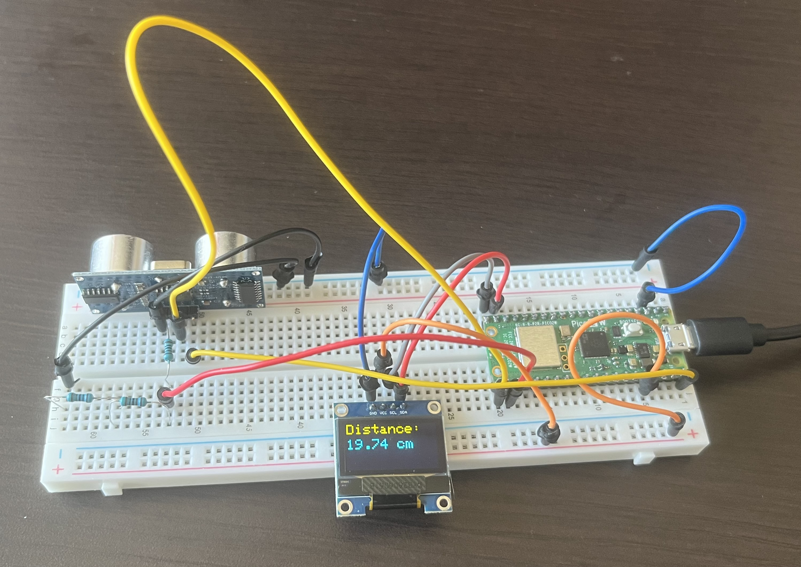

# Ultrasonic Sensor OLED Controller

## Overview
This project uses a Raspberry Pi Pico 2 W to show distance using a Ultrasonic Sensor and and OLED Display. An Ultrasonic Sensor reads the time it takes for a sound wave to return and sends it back to the microcontroller. An SSD1306 OLED display shows the current ADC reading and servo angle in real time.

## Hardware
- Raspberry Pi Pico 2 W
- HC-SR04 Ultrasonic Sensor
- SSD1306 128x64 I2C OLED Display
- 3 1k$\Omega$ Resistors
- Breadboard
- Jumper Wires

## Wiring

**Ultrasonic Sensor**
- VCC - VBUS
- GND - GND
- Trig - GP16
- Echo - GP 15

**OLED**
- VCC - 3.3V
- GND - GND
- SDA - GP14
- SDL - GP15

## Features
- Reads input from Ultrasonic Sensor
- Converts readings into distance in cm
- Displays live data on a 128x64 OLED display
- Demonstrates I2C and GPIO communication

## Results
The Ultrasonic Sensor succesfully tracked and outputted the correct distance and displayed that distance on the OLED display

## Future Improvements
- Detect object if it is too close
- Create radar scanner using
    - Servo
    - Ultrasonic Sensor
    - OLED display
- Add menu system and multiple display modes
